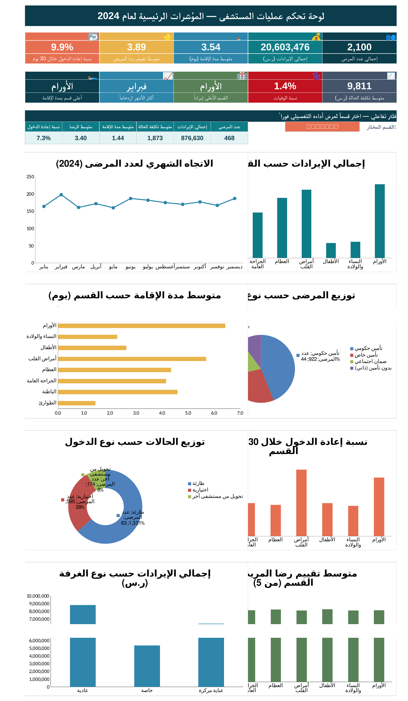
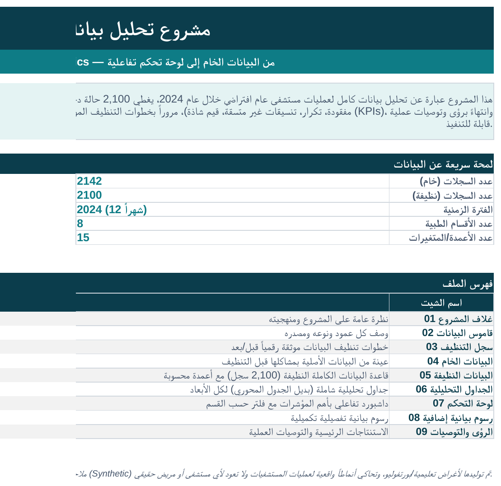

# 🏥 مشروع تحليل بيانات مستشفى | Hospital Data Analytics

مشروع تحليل بيانات كامل لعمليات مستشفى (بيانات اصطناعية) لعام 2024، مبني بالكامل على Excel — من التنظيف إلى داشبورد تفاعلي.

📄 الملف: [`hospital_analysis.xlsx`](hospital_analysis.xlsx)

---

## 📊 لوحة التحكم

## 📁 غلاف المشروع

---

## المحتوى

- تنظيف بيانات موثّق (2,142 → 2,100 سجل)
- 8 جداول تحليلية بصيغ حية (SUMIFS / COUNTIFS / AVERAGEIFS)
- داشبورد تفاعلي بفلتر حسب القسم + 8 مخططات
- رؤى وتوصيات مبنية على أرقام فعلية

## أبرز الأرقام

- الإيرادات: **20.6 مليون ريال** | متوسط تكلفة الحالة: **9,811 ريال**
- الأورام: أعلى ربحية للحالة رغم صغر حجمها
- الطوارئ: الأعلى حجماً (22%) لكن الأقل رضا (3.40/5)

---
*بيانات اصطناعية لأغراض تعليمية/بورتفوليو*
